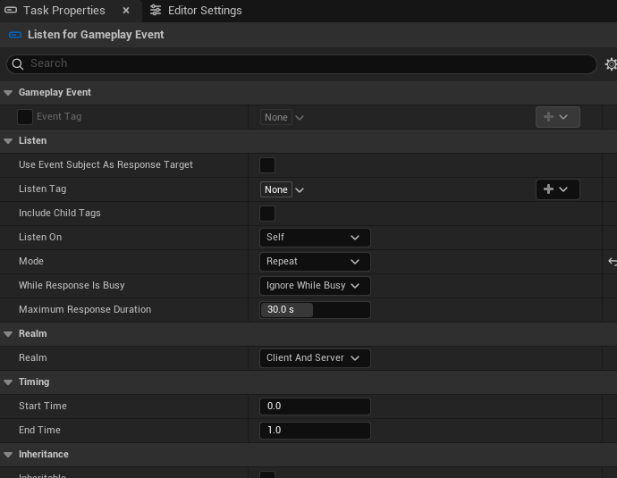
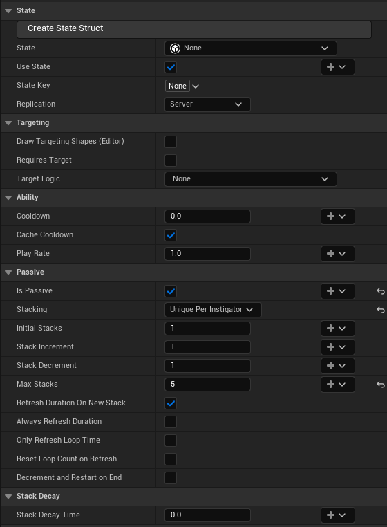

# Able · Generation 2.0

**A visual tour of the biggest improvements in our custom Able.**

Multi-phase abilities. Gameplay that reacts to events. State that survives between activations. A collision engine you can author visually.

Built on Able 3.96, targeting Unreal Engine 5.8. “Generation 2.0” describes this project's evolution, not the vendor's version number.

**[Open the full visual showcase →](https://gamesandbacon.github.io/able-generation-2-showcase/)** · [Screenshot notes](#capture-notes)

| Author | Orchestrate | Retain | Measure |
| :--- | :--- | :--- | :--- |
| Collision Shapes and viewport handles | Timelines and gameplay events | Ability State and per-instigator passives | Native shape execution and ACE Profiler |

### Choose a chapter

| Build the move | Control the execution | Improve the framework |
| :--- | :--- | :--- |
| [01 · Collision Shapes](#collision-shapes) | [02 · Multiple timelines](#timelines) | [10 · Collision performance](#collision-performance) |
| [07 · Root motion](#root-motion) | [03 · Gameplay events](#gameplay-events) | [11 · Networking and APIs](#networking-apis) |
| [08 · Ability Editor](#ability-editor) | [04 · Ability State](#ability-state) | [12 · Weapon integrations](#weapon-integrations) |
| [09 · Bindings, spawning and presentation](#task-library) | [05 · Passives](#passives) · [06 · Input](#enhanced-input) | [Testing and migration](#the-foundation-underneath) |

This catalogue focuses on the major additions and their authoring options. Smaller fixes are summarized together. Expand **Look closer** panels for additional inspector screenshots.

---

## 01 · Shape the attack

### Able Collision Engine

**The hitbox can now match the move.**

ACE replaces Able's fixed volume implementations with reusable **Collision Shapes**. Compose a shape from presets, extruded outlines, revolved profiles, repeated pieces, and other shapes. A typed **Params** struct exposes the dimensions each use can customize.

*Captured from the project's existing `CS_CrossSlash` asset. The graph constructs the volume; the preview shows its convex pieces; Params control its dimensions.*

| Inspect the construction | Reuse the building blocks |
| :---: | :---: |
|  |  |
| **Cross Slash:** debug a node's output and inspect handles in the viewport. | **Morning Star:** an exact sphere plus repeated cone spikes. |

- Use the same shape system for **queries, sweeps, overlap watchers, and targeting**.
- Bind a single parameter: grow the radius with charge while keeping the angle fixed.
- Query from ordinary Blueprint or C++ outside an ability, including async Blueprint queries.
- Inspect individual nodes, hulls, warnings, and the final volume in the live Shape Preview.

**Enables:** cleaves, ring attacks, breath cones, compound boss hitboxes, and paths built from capsules.

### A complete shape-building toolbox

| Building block | What it adds |
| :--- | :--- |
| **Exact primitives** | Box, Sphere, Capsule and Segment presets use analytic collision shapes. Box-shaped hulls can also become exact boxes automatically. |
| **Attack and perception presets** | Cylinder, Cone, Vision Cone, Arc, Dome, Star, Prism and Path cover common attack volumes, fields of view, shells, outlines and capsule paths. |
| **Custom solid construction** | Make Hull wraps a convex piece; Extrude Polygon turns an outline into height, with optional taper; Revolve Polygon spins a profile around an axis. Concave outlines are split into convex pieces. |
| **Composition** | Merge, Transform, Duplicate, Repeat and Mirror Hulls assemble reusable pieces. A Shape node can call another Shape, including your own Blueprint classes. |
| **Outline generation** | Polygon, Rectangle, Star Polygon and Arc Points generators, plus Transform, Duplicate and Merge Polygon nodes. Arrays in Params support custom paths and outlines. |
| **Typed Params** | Create Params Struct seeds parameters from a single preset node. Get Shape Params supplies typed member pins; defaults provide a reusable starting shape. Native C++ shapes use the same construction functions. |
| **Live inspection** | Per-hull colours, hull selection and provenance, point drawing, dimensions, a reference mesh, node warnings, and compiler status. Press **D** on supported graph nodes to inspect their output. |
| **Viewport handles** | Drag distances, angles, points and transforms. Handles can write a node's literal value or the Default Param feeding it; a drag becomes one undo operation. |

### Use a shape wherever the ability needs a volume

| Integration | What the author controls |
| :--- | :--- |
| **Collision Query** | Query Shape, optional Negative Query Shape, placement, filtering and individual Params. |
| **Collision Sweep** | Sweep Shape and placement; exact testing along the sweep. |
| **Watch for Overlap** | Repeated shape queries over the task's window. |
| **Targeting** | Shared or timeline-specific shapes; automatic range from shape bounds. |
| **Ordinary Blueprint** | Shape Overlap Actors, Shape Sweep Single, Shape Sweep Actors and Draw Collision Shape, with typed Params, ignored actors, object/channel filters and debug drawing. Query nodes can switch to async completion. |

*Unsaved demonstration: the existing Cross Slash class exposes Radius, Thickness, Angle, Height and Tilt inside the ability. The open menu belongs to one field's Create/View Binding button.*

Async Blueprint queries report completion on the game thread. Shapes that support worker-thread construction can build there too; other Blueprint shapes build first on the game thread. Raycasts retain their line-trace behavior.

---

## 02 · Give one ability several phases

### Multiple timelines

**Wind up. Sustain. Recover. Keep one execution.**

An ability can contain several timelines, each with its own playback, tasks, loops, channeling, and finish routes. Optional independent cooldowns and targeting also let one asset hold alternate attacks.

*Unsaved authoring demonstration: the phase tabs expose their transition routes directly. The task tracks illustrate the editor layout, not a completed combat ability.*

| Phase | What it owns | Example route |
| :--- | :--- | :--- |
| **Wind Up** | Preparation and startup timing | Finish → Sustained Attack |
| **Sustained Attack** | Looping tasks and held-input channeling | Channel fails → Recovery |
| **Recovery** | Exit animation and recovery timing | Finish → End Ability |

Transitions keep the context and execution alive. Running tasks hand off with the **Branched** result; activation checks and cooldowns are not repeated. Destinations can be bound, including weighted random choices using shared random values.

| Subfeature | What it gives us |
| :--- | :--- |
| **Independent phase settings** | Length, play-rate multiplier, Finish All Tasks, loop range and bindable maximum iterations per timeline. |
| **Two exit routes** | Separate decisions for normal completion and channel failure; finish the ability or go to another timeline. Tabs show the routes. |
| **Alternate attacks in one asset** | Optional independent cooldown and targeting, including its own Requires Target setting. Activation, range and cooldown APIs accept timeline indices. |
| **Dynamic selection** | Find Timeline, Pick Random Timeline and Pick Weighted Random Timeline; bind the next phase or choose a starting phase from AI/Blueprint. |
| **Continuity** | Targets, stacks, ability scratchpad and the execution context carry across the transition; Start/End describe the whole ability. |
| **Asset editing** | Add, rename, duplicate, reorder and remove timelines. Stable identities keep their tasks associated during reordering. Dependencies stay within a timeline. |

**Example:** one enemy ability can hold Swipe, Bite and Roar, each with its own range and cooldown, while a charged player move uses Wind Up, Sustain and Recovery.

<strong>Look closer: timeline and input settings</strong>

*The demonstration shows a two-second loop, an Input channel condition, and Recovery as the channel-failure destination.*

---

## 03 · Let abilities respond to gameplay

### Typed gameplay events

**A task can react to a result, instead of guessing when it happened.**

Tasks publish tagged notifications when they start, finish, are interrupted, or produce a supported result. Damage, spawn, collision, and barrel-shot events carry the data captured at the result site.

*The live project's registry: each tag declares its payload type. These are the project's existing entries, not newly registered showcase events.*

The **Gameplay Event Registry** gives Send, Wait, and Get Payload nodes typed Blueprint pins. Whole-payload and per-field bindings keep authored values and dynamic values together.

*Unsaved demonstration of the Listen task's Repeat mode. A gameplay tag still needs to be assigned before use.*

**Listen for Gameplay Event** releases dependent task groups on receipt. Responses get their own context and scratchpads, with one-shot or repeated listening, busy policies, bounded queues, and a response watchdog. Blueprint waits can listen across multiple components.

### From notification to an independent response

| Subfeature | What it gives us |
| :--- | :--- |
| **Typed registry** | A tag declares its payload struct or No Payload. Child tags can inherit the nearest registered parent's type. Nodes rebuild when the registry changes. |
| **Typed Send, Wait and Get Payload** | Struct pins appear from the selected tag, without manual Instanced Struct packing. A wait can observe several component wires through one input. |
| **Task lifecycle notifications** | Started, Completed and Interrupted events, plus explicit Manual sends. These report task execution; supported Result events carry the outcome captured by gameplay. |
| **Actual result payloads** | Damage: calculated/applied damage and target. Spawn: attempted actor and success/failure. Collision/raycast/overlap: filtered results, including misses. Fire Barrel: authority-side committed shot data. |
| **Component routing** | Send to Self, Instigator, Targets or a specified component. Listen can combine those sources, deduplicate them and identify the Receiving Component separately from the original sender. |
| **Response scheduling** | Descendants of a Listen task form its response group. Event Relative timing preserves duration and applies delay after receipt; Ability Timeline retains absolute timing. |
| **Repeated reactions** | Once or Repeat, Ignore While Busy or a bounded Queue, overflow counts and a maximum response-duration watchdog. Accepted responses can drain after the listening window closes. |
| **Isolated response data** | A separate context and scratchpads protect the parent execution's targets. Optionally target the event subject; read its payload and captured source metadata through the response context. |
| **Bindings at two levels** | Bind the whole payload or individual fields. Whole-payload bindings belong to the tag and can be shared by tasks sending that tag. |
| **Diagnosis and cleanup** | Bounded component dispatch, dropped-event counters, an optional development trace, cancelable waits, and unsubscribe/response cleanup on interruption or teardown. |

**Example:** a running retaliation passive listens for confirmed damage, queues accepted hits, and runs a reaction group using each hit's captured damage and target.

Ability Callbacks remain a separate mechanism: **Notify Ability / Callback Name** calls that ability's Blueprint. Gameplay events notify component listeners. Result getters and source-target getters expose captured data; retained actor references can expire.

**Enables:** reactions to confirmed hits, chained effects, repeated responses, and coordination between running abilities. Gameplay events remain local; they do not automatically replicate or activate abilities.

---

## 04 · Remember between activations

### Ability State

**An ability can retain structured data for each caster.**

Store combo progress, charges, a previous target, or character-specific values in a typed struct owned by the Ability Component. Get/Set Ability State nodes expose the struct's members directly.

- **State Key:** share state between related abilities using a Gameplay Tag.
- **State Override:** give a particular component different starting values.
- **Use State:** decide whether a caster needs storage at all.
- **Replication:** choose local state or server-authoritative state sent to the owning client.

| Subfeature | Why it matters |
| :--- | :--- |
| **Lazy creation and Has State** | Storage is made on first use; a caster with Use State disabled has none. Get/Set report whether state exists. |
| **Typed Get/Set nodes** | Member pins follow the selected struct. In the ability, use Context; elsewhere, use the Ability Component and selected ability, even without a running execution. |
| **Partial updates** | Leave Unchanged hides a Set member pin and preserves its stored value. Read-only structs instead use whole-state replacement from a connected struct. |
| **Per-character defaults** | Component State Overrides initialize a boss, player or AI differently, including abilities sharing a State Key. |
| **Reset controls** | Reset one state's shared key or all component states; subsequent use initializes it again. |
| **Editor feedback** | Selecting the State struct updates the Get/Set nodes immediately; recompiling updates member changes within the struct. |

## 05 · Keep each player's effects independent

### Passives per instigator

Two players can apply the same Burn to one enemy without sharing stacks or expiry. Each instigator gets a separate passive instance, duration, decay, and attribution. Queries and cancellation can address one instigator's application.

*Unsaved demonstration. Above: State creation, sharing, and replication controls, with no State struct selected. Below: a passive configured as Unique Per Instigator with a maximum of five stacks.*

Temporary gameplay tags are reference-counted, so one Burn ending does not clear `Status.Burning` while another still owns it.

The passive APIs accept an optional **Instigator** for targeted stack queries, stack changes, cancellation and timing. **Get Passive Instigators** lists the applications; **Get Current Passive Abilities** lists each ability once. Cancel Ability can filter passives with **Only Passives From**, and Remove One removes a stack from each affected instance. Replication carries separate instances and their stack changes.

---

## 06 · Make input part of the execution

### Enhanced Input

Branch and channel conditions use **Input Actions and trigger callbacks**. An activation carries its default action; an individual reader can override it. Listener state belongs to that execution and is detached when its listening window ends.

*Unsaved demonstration: channel while the context's input is active, then route to Recovery when the channel fails.*

**Enables:** hold-to-channel attacks, release transitions, trigger-based branch windows, and reuse of one ability with different input actions.

| Subfeature | Authoring choice |
| :--- | :--- |
| **Context Input** | Supply the action at activation; readers use that execution's default action. Same-component Branch/Play Ability can inherit it. |
| **Manual Input** | Pick or bind an action on the reader. The chosen action and trigger event are resolved once for the listening window. |
| **On Input branch conditions** | Remember a matching callback during the task window, so other branch conditions can become satisfied afterward. |
| **While Input Is Active** | Maintain a held channel from the action lifecycle; completion/cancellation clears it. An already-active action initializes from current input state. |
| **Until Event Occurs** | Keep channeling until the chosen callback, commonly Completed for release. Canceled also ends a Completed-based channel. |
| **Typed trigger selection** | Started, Ongoing, Triggered, Completed and Canceled follow Enhanced Input's action rules. Trigger Event can be bound too. |
| **Execution lifetime** | Separate listener state per execution, exact-handle cleanup and stale-callback guards; readers handle local input component replacement and lost mappings. |

Enhanced Input mappings and physical hold/release behavior still belong to the game's Input Actions and mapping contexts.

---

## 07 · Author movement as part of the ability

### Root-motion tasks

**Dashes, pulls, knockbacks, and leaps now have dedicated tasks.**

Constant Force, Radial Force, Move To, and Jump use Character Movement root-motion sources. Bindable values, curves, moving destinations, movement-mode handling, and finish-velocity controls make the tasks useful across different moves.

*Unsaved authoring demonstration: the orange volume visualizes the radial force's radius, and the location gizmo places its origin. This is an editor view, not a recorded movement test.*

| Movement | Major controls | Example use |
| :--- | :--- | :--- |
| **Constant Force** | World, Actor, Control Rotation or Control Yaw direction space; strength-over-time curve; optional gravity. | A forward dash or a dash along the player's aim. |
| **Radial Force** | Push/pull, radius, moving origin, horizontal-only force, fixed direction and distance/time falloff curves. | An explosion knockback, suction field or wind effect. |
| **Move To** | Target-type destination, tracking, stop distance, acceptance radius, keep height, path offset and time mapping curves. | Close the gap to a moving enemy and stop short of it. |
| **Jump** | Rotation space, distance, height, path/time curves, landing completion and minimum landed time. | A forward leap or backward evasive hop. |

All four share **additive/override behavior, priority, source naming, removal on task end, finish velocity, and temporary movement-mode controls**. Duration follows the ability's play rate; Move To and Jump can finish early once the character sources finish. Character Movement provides the source replication, with server and owning-client application in the default realm.

<strong>Look closer: directional force, destination tracking and jumping</strong>

*Constant Force: an authored direction and strength, with a curve slot and explicit source-cleanup/finish behavior.*

| Track a destination | Shape a jump |
| :---: | :---: |
|  |  |
| **Move To:** follow a target, maintain height and tune the path. | **Jump:** set an arc and decide when landing completes it. |

*Unsaved task inspectors. These captures show authoring options; movement was not played or measured.*

## 08 · Edit where the action happens

### Ability Editor improvements

Task locations and supported values can be adjusted directly with **viewport gizmos**, including properties exposed by custom tasks. Timeline tabs, task groups, reordering, zooming, panning, and clearer task bars improve navigation.

Preview playback gained **No Loop, Loop Ability, Loop Timeline, and Timeline Once**, plus **Force Transition** to inspect exit routes. Faster asset pickers and a repaired new-ability workflow round out the authoring improvements.

*Unsaved demonstration after Organize → Group Ungrouped Tasks by Category. Each group can collapse and has its own Add Task control.*

| Authoring improvement | What changed |
| :--- | :--- |
| **Task organization** | Named groups, drag reordering, moving tasks between groups, category grouping, expanded descriptions and searching by task/category/group. Filtering reveals matches inside collapsed groups. |
| **Timeline navigation** | Alt + wheel zooms around the cursor; Shift + wheel pans. A draggable time/frame readout supports scrubbing, and coloured leading edges make task bars easier to identify. |
| **Preview modes** | Play through the ability, replay the whole ability, loop only the current timeline, or inspect a timeline once. Force Transition follows the relevant channel-fail/finish route. |
| **Viewport editing** | W moves and E rotates supported task gizmos. Labels and per-value visibility buttons identify the value being edited; each drag is one undo. |
| **Custom-task support** | C++ metadata or a Task Blueprint variable's Ability Editor settings specify a gizmo, relative space, socket and default visibility. |
| **Preview actors and targets** | Named toolbar pickers use the Asset Registry, with search and Respawn. Add Target and Override Target show what the preview uses; F frames the actor or selected targets. |
| **New-asset workflow** | The engine class picker creates an ability with its initial timeline. A missing preview actor gets a Choose Preview Actor card. |
| **Cleaner inspection** | Expanded Location controls, immediate State-node pin refresh and Control Rig bones following Show → Bones. |

---

## 09 · Get more from the existing task library

### Bindings, spawning, animation, and feedback

*Unsaved demonstration of the reorganized Play Animation inspector. No animation asset is assigned in this capture.*

| Improvement | What it makes possible |
| :--- | :--- |
| **Per-field bindings** | Mix fixed and dynamic values in event payloads, property bags, and shape Params. |
| **Expose On Spawn variables** | Set bindable actor properties before deferred spawning finishes. |
| **Clearer animation controls** | Choose playback, duration, speed source, and end behavior explicitly. |
| **Nearby feedback** | Apply camera shakes and force feedback around a bindable epicenter. |
| **Task correctness fixes** | More dependable movement completion, controller turning, damage events, sound, particles, spawning, and possession cleanup. |

### Spawn with the right data already in place

*Unsaved demonstration using the project's existing `Throwable` class. Expose On Spawn displays its Data, Time Cooked and Instigator fields. No actor was spawned.*

Expose On Spawn values are written **before Construction Script and BeginPlay**, and before a server-spawned actor first replicates. Each value can bind independently and resolve per spawned actor. The list follows the selected class; untouched defaults follow later class-default changes, while explicit overrides are retained. Initial Velocity uses the spawn rotation, and the task's setup callback supports additional deferred initialization.

### Make animation choices explicit

| Choice | Supported modes and behavior |
| :--- | :--- |
| **Playback** | Sequence in Slot, Montage, Ability Animation Node or Direct Mesh; each exposes its relevant controls. |
| **Duration** | Animation Length or a finite Custom Duration; timeline bars show an authoring estimate for animation-driven duration. |
| **Speed** | Independent playback or following ability/timeline rates, with a bindable speed multiplier. |
| **Entry and repetition** | Start offset, montage start section, blend controls, finite repeat count and supported duration-based looping. |
| **End behavior** | Blend Out or Let Animation Finish for supported finite playback; advanced montage Exit Section on Timed End. |
| **Playback ownership** | Cleanup addresses the task's owned montage instance. Direct Mesh restores its recorded configuration when that playback still owns the mesh. |
| **Compatibility** | Old settings migrate; configurations needing author review receive validation messages. Existing binding identities are preserved. |

### Carry feedback beyond the selected target

*Unsaved demonstration: Everyone Nearby exposes the epicenter, inner/outer radii, falloff and orientation controls. No shake asset is selected.*

Camera Shake and Force Feedback can reach **Everyone Nearby** around a bindable epicenter, as well as the target players. Together with per-field bindings and viewport placement, this supports reuse of one authored task across different attack strengths and locations.

The smaller correctness changes are grouped here: task completion and cancellation, bindings, attachment, point/radial damage, controller turning, and cleanup behave more consistently. These supporting fixes underpin the larger features shown above.

---

## 10 · Make collision cheaper—and visible

### Native execution, caching, and ACE Profiler

Supported Build Shape graphs compile into **native execution steps**. Geometry and hull caches avoid rebuilding known work; tighter candidate filtering, optimized overlaps/sweeps, and parallel batches reduce query overhead.

*Captured from Tools → ACE Profiler before recording. The empty graph shows the interface; it is not a performance result.*

The profiler separates build and query costs by shape class and can display costs relative to an engine-sphere baseline. Recorded optimization experiments live alongside reproducible collision measurements in **AbleTests**.

**Evidence boundary:** the repository's A/B results describe specific measured workloads. They do not establish one universal speedup for every ability or game.

| Improvement | Where the savings come from |
| :--- | :--- |
| **Native Build Shape** | Supported graph data flow compiles to saved native steps; math, Params, composition, Branch and Select can avoid Blueprint VM dispatch. Unsupported graphs retain the VM, with compiler/preview diagnostics. |
| **Per-shape Params cache** | Geometry is reused for equal Params, with value hashing confirmed by an exact comparison, bounded least-recently-used storage and invalidation when shape/struct/defaults change. |
| **Shared compiled hulls** | Copies and transforms share hull data; known faces avoid unnecessary hull wrapping. A cross-build hull cache reuses compiled shapes. |
| **Cheaper new builds** | Faster concave-outline merging, known-face checks and shape-name lookup; query-only hulls skip mass-property work. |
| **Adaptive broadphase** | Choose suitable bounds for the shape, gather candidates once, and retain engine fallbacks for supported complex body arrangements. |
| **Tighter narrowphase** | Reject candidates and parts using bounds before exact testing; reduce repeated scene locking and test only relevant parts. |
| **Better sweeps** | Gather the sweep's candidates once, order part tests by reach and stop when remaining parts cannot improve the earliest blocking hit. Single-part shapes use exact engine queries. |
| **Reuse and parallel work** | Merge compatible touching pieces on reuse; batches use worker threads from the measured threshold of four queries. |

**ACE Profiler** records build and query costs by shape class, displays a cost graph/table, and supports comparison with an engine-sphere baseline. Its production editor UI is separate from the optional measurement/test plugin. Cache sizes and parallel thresholds remain tunable.

---

## 11 · Reduce networking and integration overhead

### Replication and everyday APIs

- **Compact contexts** omit fields whose values are implied or default.
- **Push-model support** avoids unnecessary property comparisons when enabled by the project.
- **Ability State** replicates to the owning client using compact keys.
- **Ability restarts** travel through normal active-ability replication without the extra restart multicast.
- **Try Activate Ability** combines context creation and activation into one Blueprint node.
- **Cooldown events** expose started, changed, and ended notifications; adjustment functions add or remove cooldown time.

These changes improve the framework beneath the editor features. They are source-backed changes, rather than behaviors a static screenshot can verify.

| Everyday API | Practical benefit |
| :--- | :--- |
| **Try Activate Ability** | Select an ability, get Activated/Failed execution outputs, Start Result and the created Context. Optional inputs include instigator, input action, timeline and target location. |
| **Cooldown lifecycle events** | Started, Changed and Ended let UI react without polling. Get Ability Cooldown Remaining reads seconds; Change Cooldown and Change All Cooldowns adjust existing timers. |
| **Timeline-aware activation** | Start a chosen phase from context factories, Branch, Play Ability or AI; the AI path can read its timeline index from an Integer blackboard key. |
| **Shared random values** | Per-visit random Int/Float values support corresponding choices between machines; weighted/unweighted timeline selection uses that shared source. |

Push model remains a project opt-in. Gameplay events remain local. Predicting-client timeline requests validate the destination's existence; gameplay-critical transition choices still need server control. Remaining replication limits include same-timeline restarts, passive timeline changes, and late-join shared-random behavior.

## 12 · Connect weapons and individual executions

### EasyBallistics and bindable contexts

The **EasyBallistics bridge** provides Fire Barrel and Barrel Command tasks, dynamic weapon settings, shot-time aiming, and external stat overrides. Committed shots can publish gameplay-event results.

**Bindable contexts** expose lifecycle delegates for one particular execution, including timeline changes, so callers can follow the ability they started.

Both integrations were already present in the repository's earliest snapshot. Their later evolution is part of this generation's work; the repository does not establish their original creation date.

### Weapons controlled from the ability timeline

*Unsaved inspector demonstration. Refresh, restoration and burst-interruption controls are visible; a barrel still needs to be selected or bound.*

| Subfeature | What it gives us |
| :--- | :--- |
| **Held Fire Barrel** | The ability controls a firing window while the selected barrel retains its semi-auto, automatic, burst or gatling behavior. Cleanup can interrupt a burst on completion/interruption. |
| **Explicit barrel resolution** | Bind a component directly, or select an actor plus component name/tag. Ambiguous matches fail; the held task keeps its selected barrel for consistent cleanup. |
| **Dynamic configuration** | Bind Fire Options, Overrides, Aim, Barrel Settings, Bullet Settings and Stat Provider. Apply flags choose the groups to change. |
| **Stable baselines** | Bind From Barrel Defaults supplies original settings to a binding; held-fire refresh reuses that baseline instead of repeatedly compounding a modifier. |
| **Refresh and restore** | Refresh configuration during the task; optionally restore changed groups on end. Ammo, cooldown and spooling state are not rewound. |
| **Control ownership** | Exclusive held-fire bridge control prevents overlapping bridge tasks/configuration commands from silently taking over the same barrel. Stop/Block commands remain available. |
| **Shot results** | Committed authority-side shots expose ammo class, muzzle, launch velocity, bullets and shot number as a gameplay-event result. Refused shots do not publish a shot result. |

<strong>Look closer: command vocabulary and shot-time aiming</strong>

*Nine commands cover firing, configuration, ammunition, chambering, fire modes, spool control and blocking.*

*View Trace authoring controls in the unsaved demonstration. The view component/controller and actual weapon setup are still unassigned.*

### Aim from the current muzzle to the current target

Easy Aim provides **Barrel Forward, View Direction, View Trace, World Location, World Direction and Target Actor** modes. Camera/target transforms resolve at each shot, so animated guns can launch from their moving muzzle toward the view's target. Explicit view transforms and supplied components/controllers support different camera setups.

Trace range, channel, complexity, ignored/attached actors, sweep radius and maximum correction angle are configurable. **Check View To Muzzle**, **Check Muzzle Path**, **Block When Obstructed** and behind-muzzle rejection make cover handling explicit. **Resolve Easy Aim** supports reticle previews without firing; **Last Aim Result** exposes obstruction and failure information. This aligns direction; ballistic drop/target leading remains the game's responsibility.

### Connect character and weapon stats

The actor **Easy Ballistics Value Interface** exposes **139 typed getters**: 23 barrel configuration, 80 bullet configuration, 20 aim configuration, 13 barrel-state and 3 bullet-state queries. Unchanged getters pass through their supplied defaults. Configuration resolves per shot; live-state overrides affect query results, while ammo/control commands change actual resources.

**Example:** implement the two bullet muzzle-velocity getters on a weapon or character and return `DefaultValue × 1.2`. Other settings keep their defaults, and repeated resolution does not compound the multiplier.

### Follow exactly the execution you started

Bindable contexts forward **Start, End, Interrupt, Branched and Timeline Changed** for that context. Create it, bind the delegates, then activate. The optional factory makes a fresh context; choosing the bindable context class in Able settings also supports the normal context-factory/pooling route with explicit conversion. End disconnects forwarding and clears listeners before reuse. The bridge remains optional and its subscriptions local.

---

## The foundation underneath

**AbleTests** collects editor automation, collision fixtures, and performance measurements in an optional, removable plugin. Runtime and editor responsibilities have been separated, and older assets have migration paths for timelines, collision volumes, and animation settings. Some changes still require reauthoring; the table below summarizes the main migration areas.

The historical October review records **213 passing automated tests at that checkpoint**. That is historical evidence, not a new test run or a claim that every feature has multiplayer/runtime coverage.

| Foundation | What changed |
| :--- | :--- |
| **Optional AbleTests plugin** | Correctness automation, fixture generation, visual capture tools and performance measurements live in a removable editor-only plugin, disabled by default. Production plugins do not depend on it. |
| **Broader collision evidence** | Tests compare native/VM builds, exact shapes, sync/async queries, batches and mixed collision scenes, including welded components and filtering. |
| **Reproducible measurements** | Distribution reports include workload, environment, seed, query results and latency samples; curated A/B results explain optimizations kept or dropped. |
| **Focused source organization** | Runtime/editor separation and files grouped by responsibility make the framework and collision engine easier to maintain. |
| **Lifecycle fixes** | More consistent input teardown, event dispatch, task completion and passive cancellation. Cooldown updates stay on the game thread; world-changing/Blueprint task callbacks avoid unsafe worker execution. |

### Existing assets: the main upgrade paths

| Previous authoring | Generation 2.0 path |
| :--- | :--- |
| Ability-level length, looping and channeling | Timeline 0 receives those settings; later phases can be authored separately. |
| Fixed Box/Sphere/Capsule/Cone volumes | Matching ACE presets load through the compatibility path. Able now depends on ACE. |
| Unregistered arbitrary event payloads | Register each payload tag/type, then use typed Send/Wait/Get nodes. Mismatched payloads are omitted with diagnostics. |
| Legacy key/action-name input readers | Convert supported selections and deliberately reauthor unsupported name arrays/timing behavior using Input Actions. |
| Animation checkbox combinations | Migrate to explicit playback/duration/speed/end choices and review validation messages. |
| Context named parameters | Rewire to Ability State for retained data or dynamic bindings for per-use values. |
| Old event/callback names | Gameplay Event naming distinguishes component notifications from Notify Ability / Callback Name. |
| Tag task server defaults and passive cancellation | Review intended realm and end-result assumptions; tag tasks now default to Client And Server, and passive cancellation preserves its requested result. |

The showcase covers the major feature families and their validation limits. It is not a compatibility checklist for every saved asset.

## Capture notes

- Screenshots were taken directly from the open **shootcramental / Unreal Engine 5.8** editor on **11 October 2026**.
- Cross Slash, Morning Star, and the event-registry entries came from the existing project. The profiler was captured idle.
- `AB_20_Showcase` was a temporary, unsaved authoring demonstration for timeline, input, task, passive, spawn and weapon controls. Its screenshots illustrate implemented UI, not a finished or validated gameplay ability. Selecting `Throwable` reads an existing actor class; its asset was not edited.
- Images are tightly framed screen captures. Captions describe what is visible; no UI values or profiler results were painted into the screenshots.
- The cover is an original vector illustration. No C++ build, gameplay test suite, benchmark run, or network validation was performed for this document.
- The plain Markdown and styled HTML share the same content and local images. Keep the `images` directory beside them when sharing the showcase.

---

This repository contains the visual showcase and its screenshots. Able plugin source and the Unreal project are maintained separately.
