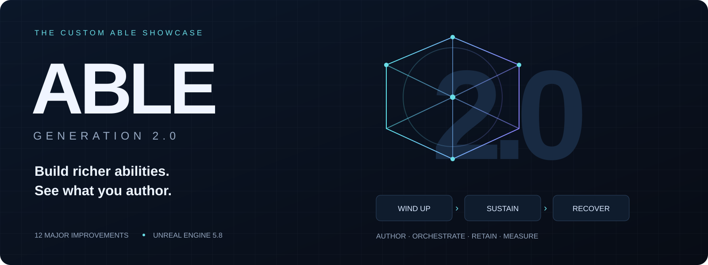

# Able · Generation 2.0

**Richer abilities. Clearer authoring. More control over every execution.**

A visual tour of our custom Able: collision shapes, multiple phases, reactive gameplay, persistent state, and weapon integration.

**[Open the full visual showcase →](https://gamesandbacon.github.io/able-generation-2-showcase/)**

Built on Able 3.96 for Unreal Engine 5.8. “Generation 2.0” names this project's evolution.

### Choose a chapter

| Build the move | Control the execution | Improve the framework |
| :--- | :--- | :--- |
| [01 · Collision Shapes](#collision-shapes) | [02 · Multiple timelines](#timelines) | [10 · Collision performance](#collision-performance) |
| [07 · Root motion](#root-motion) | [03 · Gameplay events](#gameplay-events) | [11 · Networking and APIs](#networking-apis) |
| [08 · Ability Editor](#ability-editor) | [04 · Ability State](#ability-state) | [12 · Weapon integrations](#weapon-integrations) |
| [09 · Bindings and presentation](#task-library) | [05 · Passives](#passives) · [06 · Input](#enhanced-input) | [Testing and migration](#the-foundation-underneath) |

**Browse the images. Open Look closer for the controls behind them.** On the website, click any image to enlarge it.

---

## 01 · Shape the attack

**Able Collision Engine — hitboxes that match the move.**

Build reusable Collision Shapes from presets, outlines, and repeated pieces. Preview the volume beside its graph; expose dimensions through typed Params.

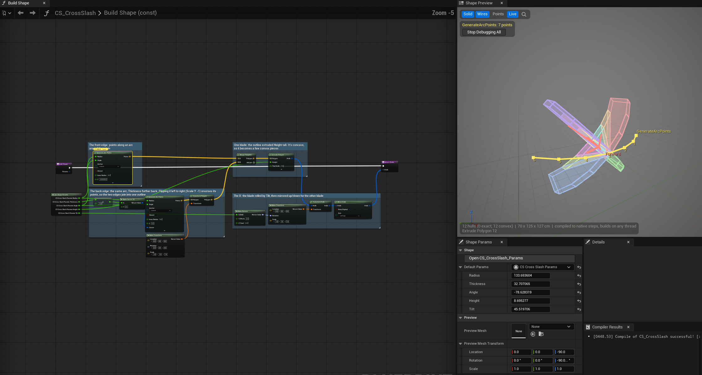

*Cross Slash: build the arc, inspect the volume, adjust its dimensions.*

<strong>Look closer: shapes, handles and individual bindings</strong>

| Inspect the construction | Compose another move |
| :---: | :---: |
| 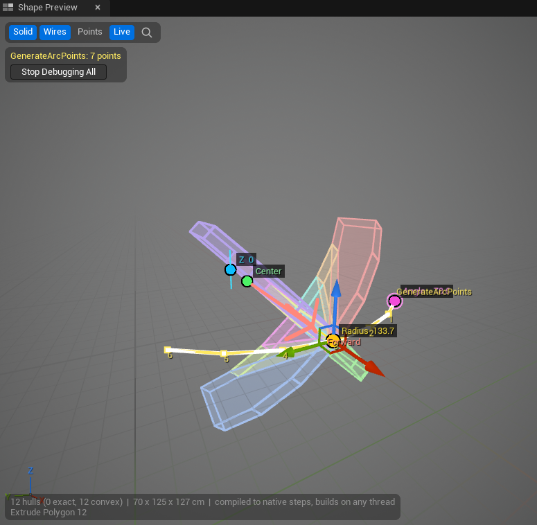 | 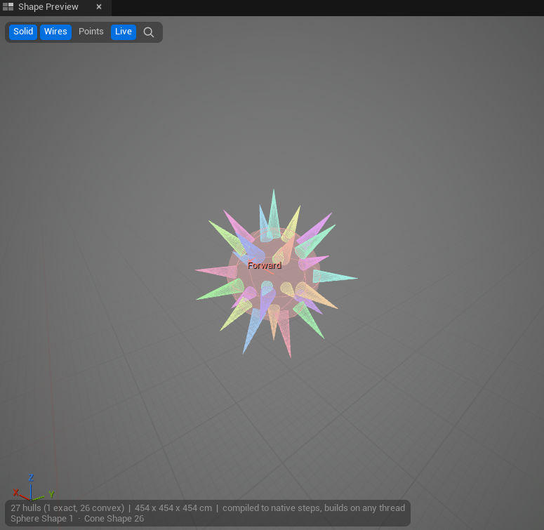 |
| **Cross Slash:** debug a node and drag its handles. | **Morning Star:** reuse and repeat smaller pieces. |

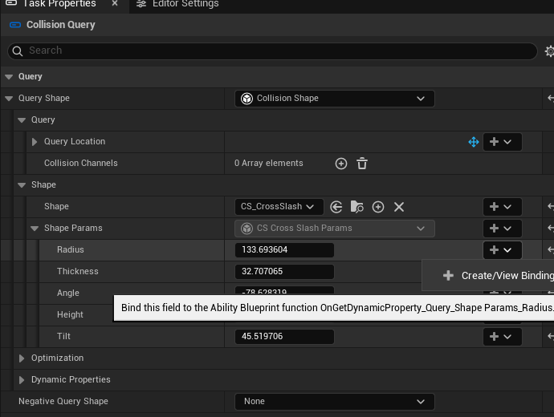

*Bind one dimension without replacing the whole parameter struct.*

- **Presets:** Box, Sphere, Capsule, Segment, Cylinder, Cone, Vision Cone, Arc, Dome, Star, Prism and Path.
- **Construction:** Hull, Extrude and Revolve; concave outlines split into convex pieces. Polygon, Rectangle, Star and Arc generators supply outlines.
- **Composition:** Merge, Transform, Duplicate, Repeat, Mirror and nested Shapes. Blueprint and native C++ share the building blocks.
- **Inspection:** coloured hulls, selected pieces, points, dimensions, warnings and undoable viewport handles.
- **Integration:** Query, Sweep, Watch for Overlap and targeting; negative query shapes, automatic range and per-field bindings. Ordinary Blueprint queries support typed Params and async completion.

Async completion returns to the game thread. Worker-safe shapes can also build off-thread; raycasts retain line-trace behavior.

---

## 02 · Give one ability several phases

**Wind up. Sustain. Recover. Keep one execution.**

Each timeline owns its tasks, playback, loops and exit routes. Phase transitions preserve the running context; alternate attacks can also own separate cooldowns and targeting.

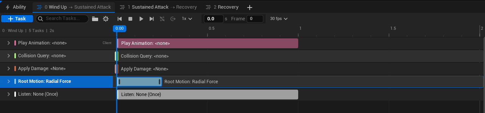

*The phase tabs show what runs next.*

<strong>Look closer: held loops and independent attacks</strong>

| Sustain until input ends | Give a phase its own attack settings |
| :---: | :---: |
| 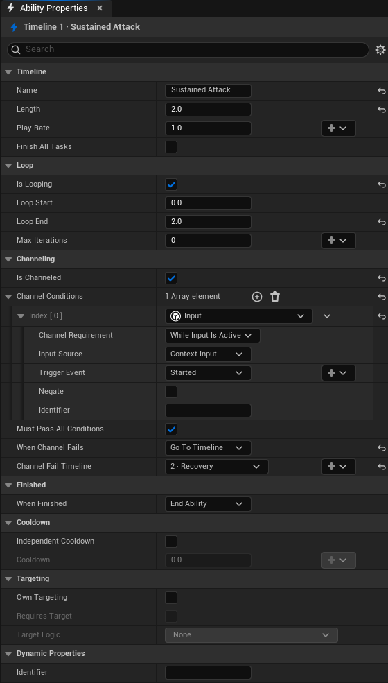 | 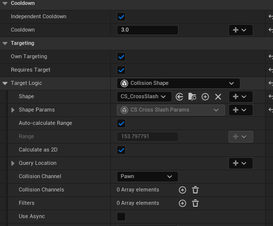 |
| **Channel failure → Recovery.** | **Own cooldown, target requirement and shape.** |

- Bind playback, loop count and destinations; route completion and channel failure separately.
- Choose a starting phase, find one by name, or pick random/weighted destinations using shared random values.
- Targets, stacks and scratchpads survive transitions. Tasks end with **Branched**; activation checks and cooldowns are not repeated.
- Add, rename, duplicate, reorder or remove phases; stable identities retain their tasks. Dependencies stay within a timeline.

---

## 03 · React when gameplay happens

**Typed gameplay events — respond to a result, instead of guessing its timing.**

Tags declare payload types. Send and Get Payload expose those types in Blueprint; Listen tasks release response groups when a matching event arrives.

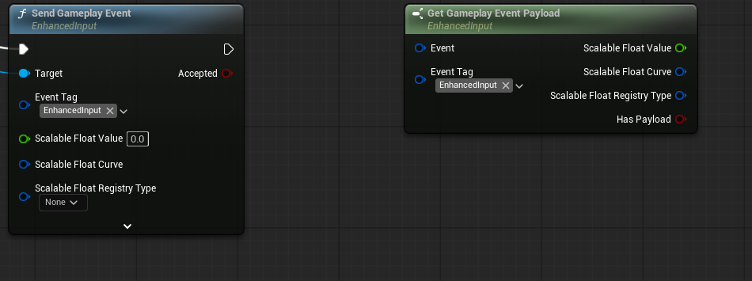

*An existing registry tag supplies the payload type. Split pins expose its members.*

<strong>Look closer: the registry and repeated responses</strong>

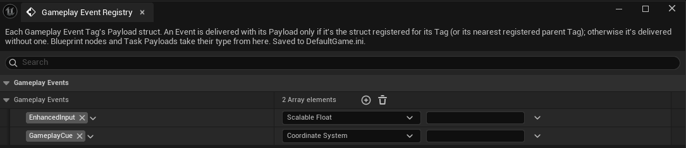

*Declare the tag and type once; author with typed pins.*

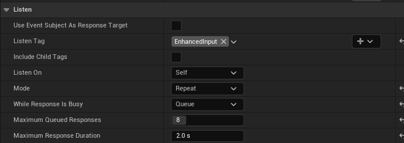

*Listen repeatedly, queue accepted events, and bound how long a response may run.*

- **Publish:** Started, Completed, Interrupted, Manual and supported Result events. Damage, spawn, query and committed barrel-shot results carry captured outcomes.
- **Route:** Self, Instigator, Targets or a specified component; combine sources and Blueprint waits across components.
- **Respond:** Once/Repeat, Ignore While Busy/Queue, limits and overflow counts. Dependents use event-relative delay or timeline timing.
- **Isolate:** each response gets its own context and scratchpads; optionally target the event subject. Read captured payload and source metadata.
- **Bind and diagnose:** whole payloads or individual fields, child-tag type inheritance, bounded dispatch, dropped-event counters, trace and clean cancellation.

Gameplay events are **local**; they do not automatically replicate or activate abilities. Ability Callbacks remain separate.

---

## 04 · Remember between activations

**Ability State — structured memory for each caster.**

Keep charges, combo progress or a previous target on the Ability Component. Typed Get/Set nodes expose the selected struct's members.

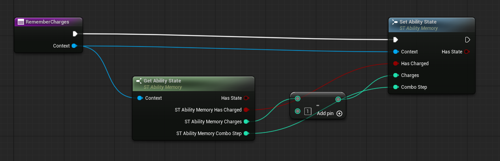

*Read the caster's values, change one, and retain the others.*

<strong>Look closer: defaults, sharing and replication</strong>

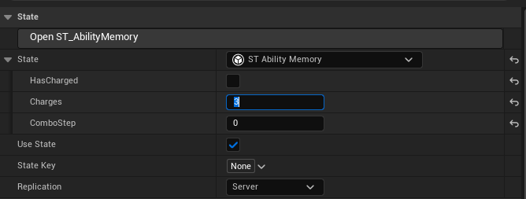

*Choose the struct, starting values, sharing key and replication policy together.*

- **Lazy storage:** create on first use; **Use State** can disable storage for selected casters. **Has State** reports availability.
- **Shared memory:** related abilities share a **State Key**. Component **State Overrides** supply different defaults.
- **Typed updates:** Context inside an ability; Component + Ability elsewhere. **Leave Unchanged** preserves a member without a Set pin; read-only structs use whole-state replacement.
- **Lifecycle:** reset one key or all states; struct/member edits refresh nodes.
- **Replication:** Local per machine, or server-authoritative values sent to the owning client.

---

## 05 · Keep each player's effects independent

**Passives per instigator — separate stacks, expiry and attribution.**

Two players can apply the same Burn to one enemy without sharing its lifetime. Query, change or cancel one instigator's application.

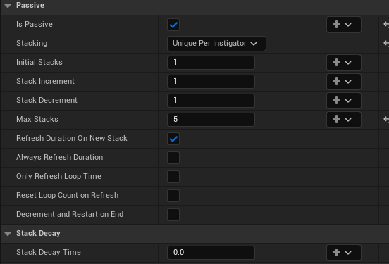

*One ability type. A separate passive instance for each instigator.*

<strong>Look closer: inspect ownership and cancel selectively</strong>

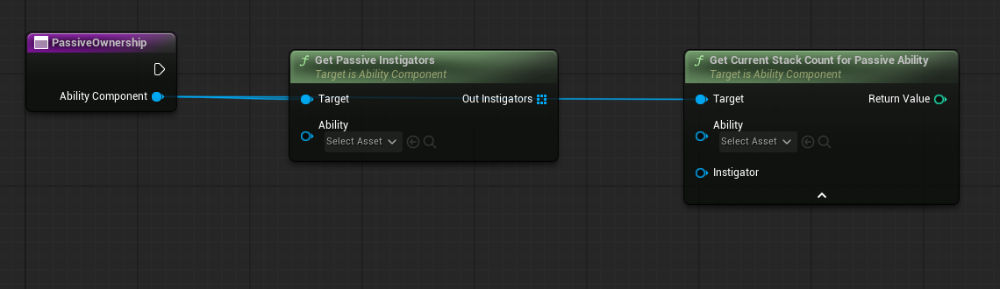

*List the applying actors, then inspect a particular actor's stacks.*

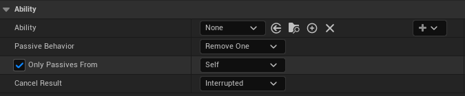

*Remove your own application without clearing somebody else's.*

Stacks, duration, decay and cooldowns are independent. APIs accept an optional **Instigator**; Get Current Passive Abilities lists each ability type once. Replication carries separate instances and stack changes.

Temporary tags are reference-counted: one effect ending keeps `Status.Burning` while another still owns it. **Remove One** removes a stack from each affected instance.

---

## 06 · Make input part of the move

**Enhanced Input — hold, release and branch with Input Actions.**

Use the activation's Context Input or select a Manual Input. Channel and branch readers listen to trigger callbacks for their execution window.

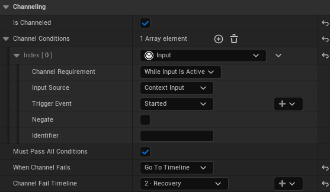

*Hold the channel; route to Recovery when input stops.*

<strong>Look closer: input modes and listening windows</strong>

- **On Input branches** remember a callback while other conditions become ready.
- **While Input Is Active** follows the action lifecycle; **Until Event Occurs** ends on the selected callback, commonly Completed for release.
- Choose **Started, Ongoing, Triggered, Completed or Canceled**. Bind the action/trigger; same-component Branch/Play Ability can inherit Context Input.
- Listeners belong to one execution and detach at the window's end, including input-component replacement and lost mappings.

Physical hold/release behavior comes from the game's Input Actions and mapping contexts.

---

## 07 · Author the movement

**Root-motion tasks — dashes, pulls, knockbacks and leaps.**

Four dedicated tasks use Character Movement sources. Bind values, shape motion with curves, and control how velocity finishes.

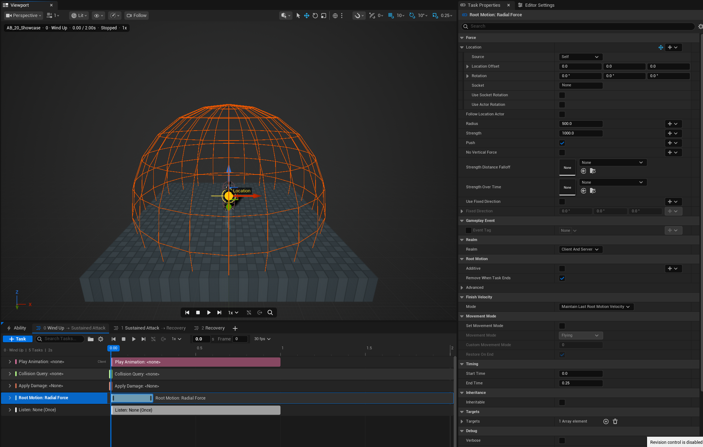

*Place the origin. Preview the radius. Author the push or pull.*

<strong>Look closer: directional force, tracking and jumping</strong>

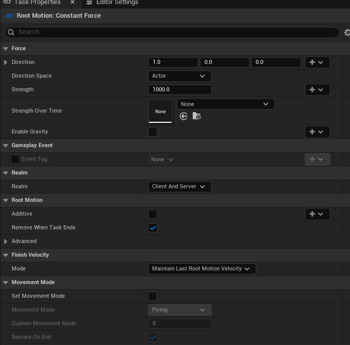

*Choose the direction space and strength curve for a dash.*

| Close the gap | Leave the ground |
| :---: | :---: |
| 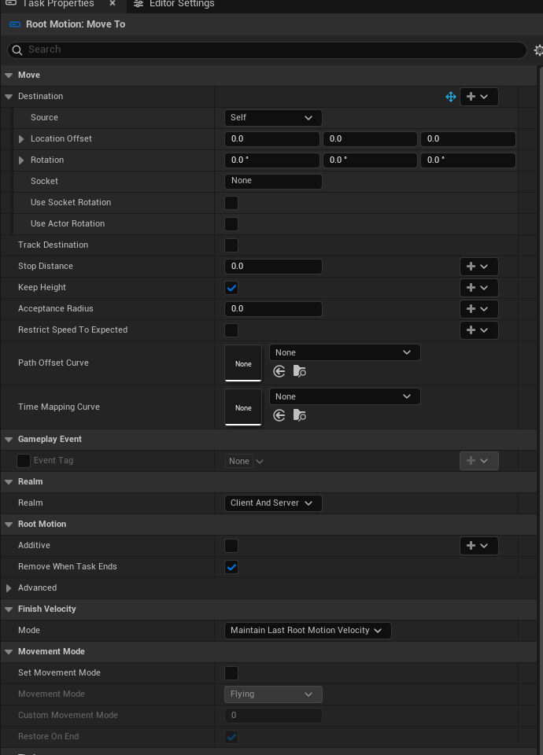 | 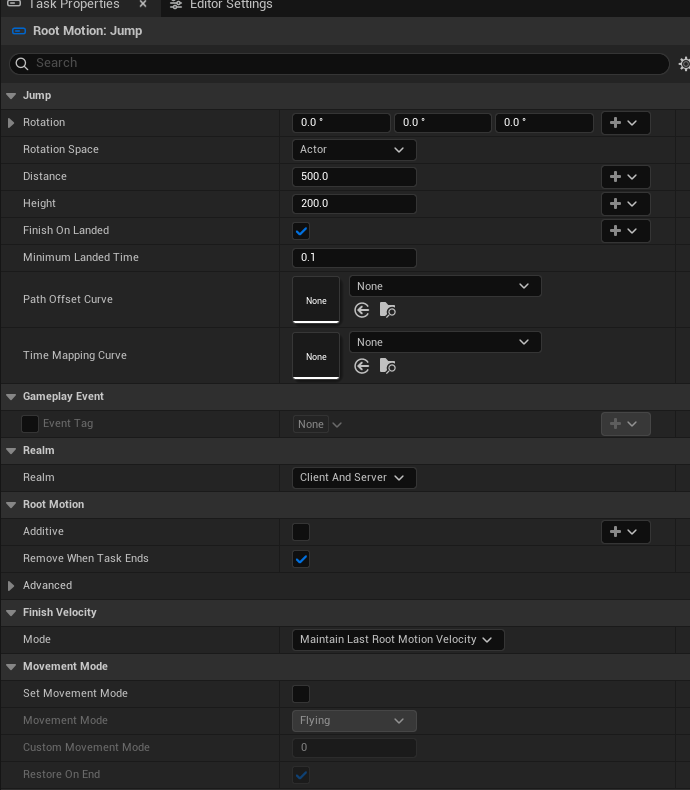 |
| **Move To:** track a destination and stop short. | **Jump:** shape the arc and finish on landing. |

| Task | Main controls |
| :--- | :--- |
| **Constant Force** | World/Actor/Control Rotation/Control Yaw direction, strength curve, gravity. |
| **Radial Force** | Push/pull, moving origin, radius, horizontal force, fixed direction, distance/time falloff. |
| **Move To** | Tracking, stop distance, acceptance radius, keep height, path offset/time curves. |
| **Jump** | Rotation space, distance, height, path/time curves, minimum landed time. |

All share additive/override behavior, priority, source naming, cleanup, finish velocity and temporary movement-mode controls. Duration follows play rate; Move To/Jump can finish early. Character Movement provides source replication, with server and owning-client application by default.

---

## 08 · Read the ability at a glance

**Ability Editor — clearer tracks, phase routes and preview controls.**

Task groups separate presentation, collision, damage, movement and reactions. Search and collapse tracks to keep a larger ability readable.

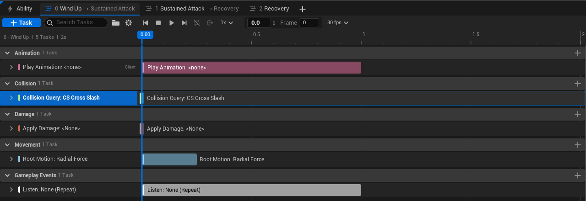

*Follow each system's timing without losing the whole move.*

<strong>Look closer: editing and preview improvements</strong>

- **Organization:** named groups, drag reordering, moving tasks between groups and category grouping. Search task/category/group, including collapsed matches.
- **Navigation:** cursor-centred Alt + wheel zoom, Shift + wheel pan, draggable time/frame scrubbing and clearer task bars.
- **Spatial editing:** W/E moves/rotates labelled task gizmos; per-value visibility and one undo per drag. Custom task variables can declare relative space, socket and visibility.
- **Preview:** No Loop, Loop Ability, Loop Timeline, Timeline Once and Force Transition. Faster searchable actor/target pickers, Respawn, Add/Override Target and an initial-timeline new-asset workflow.

---

## 09 · Bind it. Spawn it. Present it.

**Richer task authoring — customize each use of the move.**

Spawn Actor exposes the chosen class's spawn variables with dynamic bindings. Animation and camera-shake controls make presentation easier to configure.

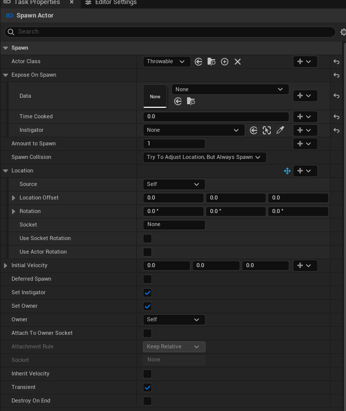

*The selected class supplies the fields. Bind values for this execution.*

<strong>Look closer: animation, camera shake and task bindings</strong>

| Author the playback | Share the impact |
| :---: | :---: |
| 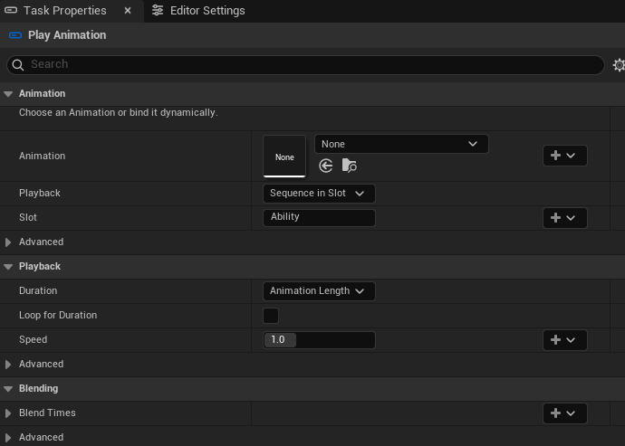 | 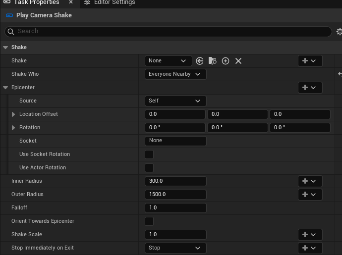 |
| **Animation:** explicit playback, timing and blending. | **Camera shake:** nearby players with spatial falloff. |

- **Spawn:** class-aware typed variables, defaults/bindings, deferred initialization, attachment and result events.
- **Animation:** playback mode, duration/speed policies, start position, looping, blending, end behavior and migration validation.
- **Shake:** target/nearby recipients, bindable epicenter/radii/falloff, and owned-instance cleanup.
- **Bindings:** broader dynamic values, identifiers and Create/View Binding controls. Effects, sound and ability playback receive supporting authoring/lifecycle improvements.

Smaller completion, cancellation, attachment, damage, turning and cleanup fixes are grouped here rather than listed task by task.

---

## 10 · Make collision cheaper—and visible

**Native shape execution, caching and ACE Profiler.**

Supported shape graphs compile into native execution steps. Geometry reuse and tighter queries reduce repeated work; the profiler separates build and query costs by shape.

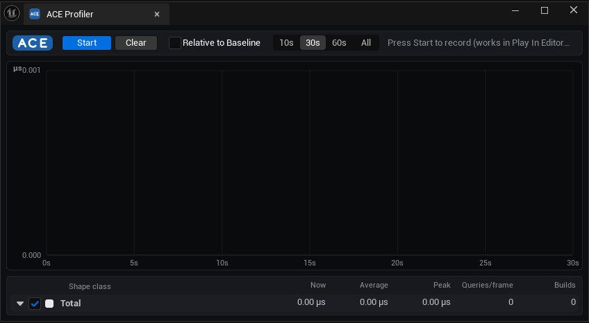

*The profiler interface, captured idle. No measurements are shown here.*

<strong>Look closer: where the savings come from</strong>

- **Native Build Shape:** supported math, Params, composition, Branch and Select avoid Blueprint VM dispatch. Unsupported graphs retain the VM with diagnostics.
- **Reuse:** bounded Params caches, shared hulls, cross-build caching and source-change invalidation.
- **Geometry:** faster outline merging, known-face checks and query-only builds; compatible touching pieces can merge on reuse.
- **Queries:** adaptive broadphase, tighter bounds rejection, less scene locking and sweep tests ordered to find earlier blocking hits.
- **Batches and visibility:** worker-thread batches, tunable thresholds, per-shape build/query recording and an engine-sphere comparison baseline.

Repository A/B measurements cover specific workloads, not a universal speedup. The production profiler is separate from the optional test plugin.

---

## 11 · Start abilities. Follow the result.

**Simpler APIs and leaner replication underneath.**

Try Activate Ability creates the context and reports Activated/Failed in one node. Cooldown notifications and adjustments give UI and gameplay direct timer control.

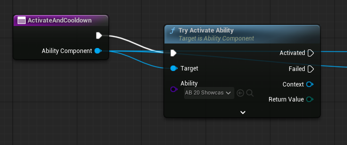

*Start the selected ability and handle the outcome directly.*

<strong>Look closer: cooldown controls and networking changes</strong>

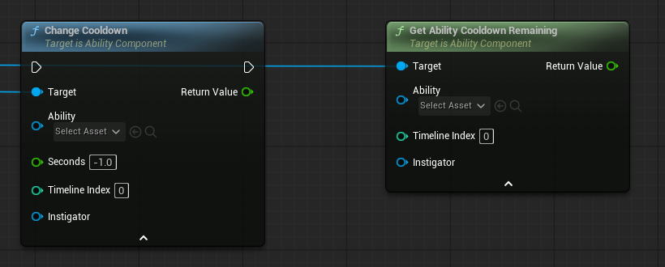

*Adjust a timer in seconds, or read one phase/instigator's remaining time.*

- **Activation:** optional instigator, input action, starting timeline and target location. Blueprint and AI can select an attack phase.
- **Cooldowns:** Started/Changed/Ended notifications, remaining seconds and single/all-timer adjustments.
- **Replication:** compact contexts omit implied/default values; project opt-in push model avoids unnecessary comparisons. State uses compact keys for owning-client replication; restarts use normal active-ability replication.
- **Shared choices:** per-visit random Int/Float values support corresponding timeline selections between machines.

Screenshots show the APIs, not network traffic. Gameplay-critical transitions still need server control. Remaining replication limits include same-timeline restarts, passive timeline changes and late-join shared randomness; gameplay events stay local.

---

## 12 · Connect the weapon to the move

**EasyBallistics and bindable execution contexts.**

Fire Barrel and Barrel Command put weapon control on the timeline. Bind settings, aim at shot time, and publish committed-shot gameplay results.

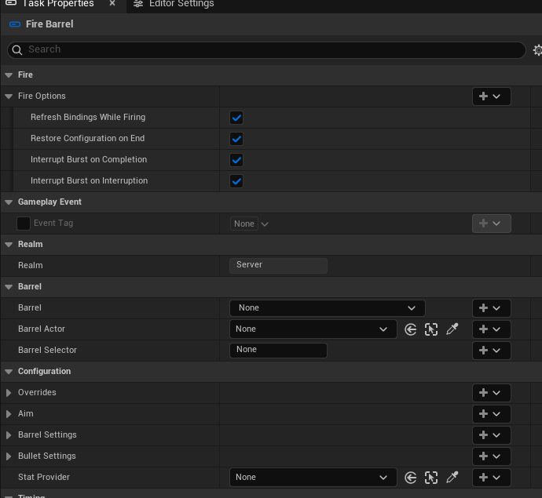

*Refresh configuration while firing; choose how it restores or stops.*

<strong>Look closer: barrel commands and shot-time aiming</strong>

| Control the weapon | Resolve the aim |
| :---: | :---: |
| 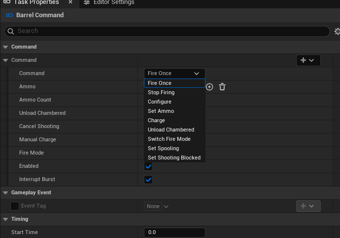 | 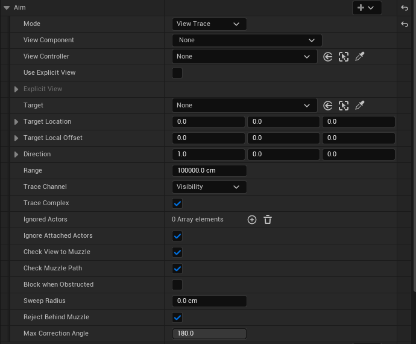 |
| **Commands:** fire, stop, configure, reload and more. | **Easy Aim:** choose the source and handle obstructions. |

- Select barrels explicitly or through targets; bind configuration and refresh/restore policy.
- Command firing, ammo, charge, chamber unloading, fire mode, spooling and shooting blocking.
- Aim through View Trace, a world point, actor or component; configure view source, offsets and obstructions. Dynamic binding and barrel delegates remain available.
- Apply external stat overrides with **139 typed value getters**. Result events expose committed authority-side shot data and captured bullet references.

<strong>Look closer: follow one execution's lifecycle</strong>

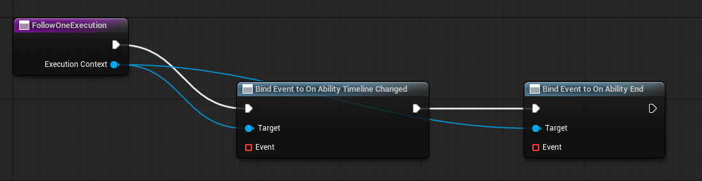

*Subscribe to the execution you started. Connect event handlers to react.*

Bindable contexts expose Start, End, Interrupt, Branch and Timeline Changed delegates. Typed factories and conversion support ordinary and pooled contexts; end cleanup removes forwarding/listeners before reuse. The integration is optional and local.

Both bridges existed in the repository's earliest snapshot; their later evolution is part of this generation.

---

## The foundation underneath

**Optional test tooling. Clearer plugin boundaries. Upgrade paths for existing assets.**

AbleTests groups editor automation, collision fixtures and reproducible measurements in a removable editor plugin. Production plugins do not depend on it.

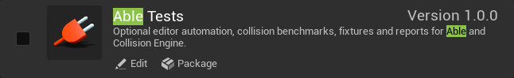

*Available when needed; disabled in the captured editor session.*

<strong>Look closer: modular plugins and migration</strong>

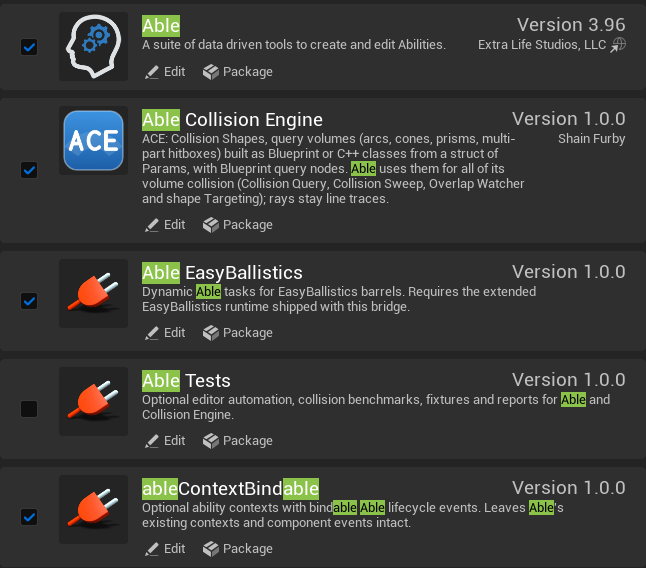

*The framework, collision engine and bridges have distinct responsibilities.*

Automation covers shape builds, query variants, batches, filters and lifecycle behavior. Reports record workloads, environment, seeds and latency distributions. The October review recorded **213 passing tests at that checkpoint**; this showcase did not run a new suite.

| Existing authoring | Main upgrade path |
| :--- | :--- |
| Ability-level playback | Move to Timeline 0; author later phases separately. |
| Fixed collision volumes | Load matching ACE presets through compatibility conversion. |
| Arbitrary event payloads | Register tag/type pairs; use typed Send/Wait/Get nodes. |
| Legacy input | Adopt Input Actions; review unsupported old timing/name arrays. |
| Animation checkboxes | Review explicit playback, duration, speed and end policies. |
| Context named parameters | Use retained Ability State or per-use dynamic bindings. |
| Events, tags and cancellation | Review Event/Callback naming, task realm and end-result assumptions. |

Some assets need deliberate reauthoring; this is a feature tour, not a complete compatibility checklist.

<strong>About these captures</strong>

Captured directly from **shootcramental / Unreal Engine 5.8** on **11 October 2026**. Cross Slash, Morning Star and registry entries are existing assets. The profiler is idle; AbleTests is disabled.

`AB_20_Showcase` and `ST_AbilityMemory` are temporary, unsaved authoring examples. Graphs and inspectors demonstrate controls, not validated gameplay implementations. Existing asset classes and registry entries were read without editing them.

Images are tightly framed screen captures; UI values/results were not painted into them. The cover is an original vector. No C++ build, gameplay suite, benchmark or network validation was run for this document.

Markdown and the website share content and local images. This public repository contains only the showcase/media; plugin source and the Unreal project are maintained separately.

